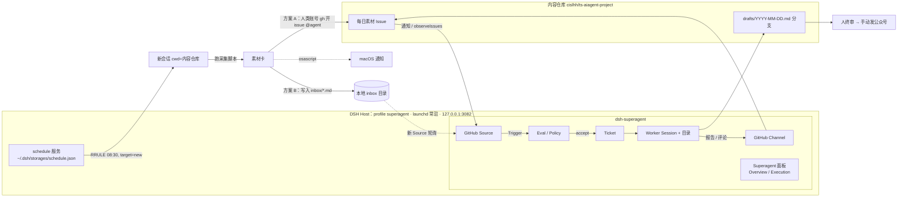

# dsh-superagent + DSH：每日自动触发、插件扩展点与通知

研究工单：[#9](https://github.com/cislhh/ts-aiagent-project/issues/9)（地图 #7）。范围：本机 macOS + DSH，不部署服务器；dsh-superagent 核心不改；目标链路是「每天自动从工作仓库提取素材 → superagent 出摘要/初稿 → 本地 Markdown 可见 → 人终审后手动发公众号」。

结论先行（细节与证据在下面各节）：

1. **DSH 定时任务活在 Host 进程里**，任务存在 `$DSH_HOME/storages/schedule.json`（或 SQLite 后端），Host 不在就完全不会触发；桌面 app（关窗进托盘）和 `dsh --profile <x>`（tmux / launchd）都能当 Host，`headless` profile 不带 Host，跑不了定时。重启后只补「最近一次」错过的重复任务，投递是 at-least-once。
2. **定时任务能往已有会话投 prompt，也能每次新建会话**（新会话继承创建者的 cwd 与 preset），但**不能直接触发 superagent**：superagent 没有 Trigger 注入 API，3082 的 HTTP 路由只有 requeue/retry/stop 这类「处理已有 Trigger」的操作，orchestrator 只能评估已经进门的 Trigger。
3. **不改核心只有两条注入口**：① 让另一个账号在受监听仓库里开 Issue / 发评论，被现有 GitHub Source 读到；② 写一个轮询本地文件的 **Source 插件**。写文件这条路必须新代码。
4. **superagent 的可扩展面只有 Source**：`SourceKind` + `SourceRegistry` + `orchestrator` 服务；Channel、Policy 表、执行环境变量、Thread 上下文都挂在 Source 上一起声明。Executor 不能替换，Eval 只能改设置和规则文本。第三方插件可以在 profile 里 `inject: ['orchestrator']` 注册 kind，但这不在官方契约里（无类型导出、无文档）。
5. **推荐 A 起步、C 收口**：A = DSH 定时 → 新会话跑采集脚本 → 以人类账号开 issue @智能体 → 现有 GitHub Source 出票 → worker 把 `drafts/<date>.md` 写进 worktree 并推分支，0.5–1 人日；稳定后转 C = 加一个本地 `inbox` Source 替掉 GitHub 总线（2–4 人日）。飞书当前不可用；通知以「本地文件 + GitHub + `osascript`」为主，DSH 桌面通知覆盖不到独立的 superagent Host。

---

## 1. 现场：现在到底跑着什么

| 事实 | 证据 |
| --- | --- |
| superagent 是独立 profile，bundles = `dsh-base` + `dsh-web-app` + `dsh-superagent` | `~/.dsh/profiles/superagent/package.json:9-13` |
| 面板/web 服务在 `127.0.0.1:3082`，stateDir 在 `~/.dsh/state/superagent` | `~/.dsh/profiles/superagent/cordis.patch.yml:2-8` |
| 该 Host 由 tmux 会话 `dsh-superagent` 承载 | `tmux ls` → `dsh-superagent: 1 windows (created Sun Nov 8 22:02:20 2026)` |
| 并且有 launchd 看护：登录即启、`KeepAlive`、每 300 秒 `status`，异常则 restart | `~/Library/LaunchAgents/com.azo.dsh-superagent.plist:16-19`；`~/.local/bin/dsh-superagent-keepalive:11-24` |
| 3082 活着（带 token，裸 curl 返 401） | `curl -o /dev/null -w '%{http_code}' http://127.0.0.1:3082/` → 401 |
| 全局 schedule 存储存在但**空**：unit v1，`tasks: {}` | `~/.dsh/storages/schedule.json:1-10` |
| DSH 桌面 app 是另一个 Host（`127.0.0.1:59837`），关窗进托盘，通知开关含定时任务完成/失败 | `~/.dsh/desktop-preferences.json:2,14,19`；`curl 59837` → 403 |
| 现有 Source 只有 GitHub（Feishu 插件在 bundle 里默认 disabled） | `~/src/dsh-superagent/cordis.patch.yml` 的 insert 段；`src/sources/feishu.ts:131-136` |

两个 Host 共用同一个 `$DSH_HOME`，所以 `~/.dsh/storages/schedule.json` 是**同一份文件**——见 §7 的不确定点 2，别在两个 Host 上同时用 schedule。

---

## 2. DSH 定时任务怎么运行

### 2.1 持久化

- 默认 JSON：`<DSH_HOME>/storages/schedule.json`，整个 unit 一次性重写；SQLite 后端则存在 `u_schedule_tasks` 表（`value` 是整条任务的 JSON 文本），物理 schema 不随任务版本变。任务 unit 当前是 `version: 2, compatibleVersions: [1]`（`app.asar!node_modules/@deepseek-ai/dsh-schedule/README.md:83`，安装版 0.2.2-rc.1）。
- 任务字段：`record`（`id`/`kind`/`title`/`prompt`/`scheduledAt` + 该 kind 的字段）、`target`、`status`（active/paused/ended）、`involvedSessionIds`、`createdAt/updatedAt`、`lastDelivery` / `deliveryHistory`、`pendingDelivery`（同上 `:110-118`）。
- 本机实测是 v1 空文件（`~/.dsh/storages/schedule.json:1-10`），说明还没建过任务；v1 会被 v2 解码器兼容并在首次写入时升级（`:157-166`）。
- 任务**不属于某个 Session**：工具读改任意任务，只有 target 才指向会话（`app.asar!node_modules/@deepseek-ai/dsh-tool-schedule/lib/index.js:3-6` 的模块注释）。

### 2.2 谁在跑 / 是否要桌面 app 常驻 / 能否 headless

- **必须有 Host 进程**：「Tasks survive restarts, but the Host must be running to deliver them」（`dsh-schedule/README.md:13`）；「Closing the Host stops scheduling until it starts again」（`docs/user/guide/schedule.md:61`）。任务本身落盘不丢，只是不触发。
- **不需要桌面 app**：`dsh --profile web` / `dsh --profile superagent` 本身就是 Host（`packages/bundle/web-app/README.md` 的启动段）。superagent 现在就是 `scripts/dsh-superagent start` 起在 tmux 里（`docs/006-deployment.md:103`），外面再套 launchd 看护——**这条路径已经天然满足「常驻」**。
- **桌面 app 也能当 Host**，但它是另一个进程：只有它自己的会话/通知在它手里（见 §5）。
- **headless profile 不行**：它「mounts no Host, HTTP server, Web runtime」（`packages/bundle/headless/cordis.patch.yml:1-5`），schedule 服务是 web-app bundle 插进去的（`packages/bundle/web-app/cordis.patch.yml:139-140`）。所以 `dsh headless` 是「一次性跑完退出」，不能挂定时。
- 结论：常驻靠 launchd 保 `dsh --profile superagent`（或桌面 app），**不要求 GUI 常开**；tmux 顶多算第二层保险。

### 2.3 错过是否补跑 / 投递语义

- 重启后：一次性任务补发（overdue 也发），重复任务**只补最近一次**错过的 occurrence（`docs/user/guide/schedule.md:61`；`dsh-schedule/README.md:13`）。
- at-least-once：入队与回执是两次提交，崩溃可能重复投递；「exactly-once 不保证」（`dsh-schedule/README.md:178,230-231,281`）。
- 投递地板 60 秒（`new` 目标另有 `newSessionIntervalSeconds`，同样 ≥60s，`README.md:60,286`）。
- 投递只是「把一条 user 消息写进目标会话的 inbox」（producer kind = `schedule`），不是执行结果；是否真的跑完要看会话（`README.md:230,281`）。
- 失败无重试循环：恢复/创建/入队失败会把任务留着并告警，等下一次管理变更、唤醒或重启再试（`README.md:280`）。

### 2.4 `schedule_create` 的 target 语义

工具 schema 的原文（`app.asar!node_modules/@deepseek-ai/dsh-tool-schedule/lib/index.js:396`）：

| target | 含义 | 关键约束 |
| --- | --- | --- |
| `this_session` | 投回当前会话 | 上一次没跑完就等；期间错过的只投最近一次 |
| `new_once` | 预留一个新会话 id，首次投递时创建，之后一直复用 | 同上「等上一次」 |
| `new` | 每次投递都新建会话 | 可并发；有最小间隔；**新会话继承创建者的 cwd 与 preset** |

- 结构上 `target` 是对象：`{kind:'session', sessionId}` / `{kind:'new_once', sessionId, create:{cwd,agentPreset}}` / `{kind:'new', create:{cwd,agentPreset}}`（`dsh-tool-schedule/lib/index.js:20-72`）。
- `create` 虽然可传，但**工具会用调用者自己的会话自动填**：`cwd = agent.session.header.cwd`，`agentPreset = composedPreset`（`dsh-tool-schedule/lib/index.js:486-492`）。也就是说：**任务在哪个目录的会话里创建，以后每天的新会话就在哪个目录、用哪个 preset**。
- `session` target 要求目标「existing, unarchived, non-delegated」，未加载的会话只用 header 做 `stat()` 校验、不激活（`dsh-schedule/README.md:72`）。
- 时间用 RRULE：一行 `DTSTART` + 一行 `RRULE`，`COUNT ≤ 1000`，不支持 `SECONDLY`，TZID 用 IANA 时区（`dsh-tool-schedule/lib/index.js:385` 的 RRULE_HELP；本会话工具描述同源）。

> 实践含义：想每天 08:30 在内容仓库里起一个全新会话，就在**该仓库目录下**的会话里创建任务（`target: new`），而不是在 superagent 的 panel 会话里创建——否则新会话的 cwd 会落在 `~/.dsh/state/superagent`。

---

## 3. 定时任务能做什么、不能做什么

| 想做 | 能不能 | 依据 |
| --- | --- | --- |
| 往指定会话投一段 prompt | 能（`session` target） | `dsh-schedule/README.md:72` |
| 每天开一个新会话跑活 | 能（`new`，继承 cwd/preset） | `dsh-tool-schedule/lib/index.js:396,486-492` |
| 直接调 superagent 的 orchestrator | **不能** | orchestrator 只处理 Source 递进来的 Trigger（`docs/001-domain.md:7`）；主 Session 的工具全是 `orchestrator_*` 对已有 Trigger/Ticket 的操作（`src/app/tools/main.ts:127-279`） |
| 调 `127.0.0.1:3082` 造一个 Trigger | **不能** | 路由表只有 `GET state/overview/sources/threads/tickets/...`、`POST triggers/:id/requeue`、`POST tickets/:id/retry|stop`、settings/prompts 等（`src/app/http.ts:151-206`），没有任何「接收新 Trigger」的路由；且需要同源 cookie/token（`http.ts:234-243`） |
| 在 GitHub 开 issue/评论，让 GitHub Source 读到 | 能，但要绕两个坑 | 见下 |
| 写个本地文件让现有 Source 轮询 | **不能**，没有文件类 Source | `docs/001-domain.md:68` 列出只有 Feishu / GitHub |
| 让定时任务给人发通知 | 只能间接（脚本里 `osascript` / 写文件 / 开 issue） | schedule 的「通知」只指投递进会话 |

**GitHub 这条路的两个坑**：

1. **智能体自己发的会被丢掉**。仓库级流里有 `if (sameName(item.user.login, login)) continue`（`src/sources/github.ts:227`），Source 也会先丢掉 bot 自己的消息（`docs/001-domain.md:27`）。所以「以智能体账号开 issue 来触发自己」是无效的。
2. **接收范围要打开**。仓库级新 Issue / 评论默认关闭（`observeIssues` / `observeComments` 默认 `false`，`src/sources/github.ts:27,50-56`），打开后「从打开的时刻开始，不读以前的」（`:51`），且受 14 天 horizon 限制（`src/sources/poll.ts:6`）。替代路径是**通知入口**：人类账号开 issue 时 `@智能体账号`，进智能体的 GitHub notifications，Source 本来就读通知，无需开 observe 开关。

这两点合起来给出方案 A 的形状：**用人类账号（`cislhh`）发、正文 @ 智能体账号**——`addressed: mention` + 在 allowed list 上 = 显式请求（`docs/002-authorization.md:11-16,50-52`），且显式请求在任何 accept mode 下都成立（`:93-101`），不需要开 auto、不需要写主动规则。

---

## 4. dsh-superagent 的扩展点

### 4.1 Source 是唯一的正式扩展面

- `SourceKind` 契约在 `src/sources/kind.ts:85`，包含：`kind`（稳定 id）、`title/description`、zod `schema`、面板 `fields`、`health` 条目；可选 `scope`、`channel`、`threadContext`、`find`、`policy`、`environment`、`refreshLabels`（`docs/007-architecture.md:185`）。
- 注册：`ctx.orchestrator.sources.register(kind)` 返回 disposer；`SourceRegistry` 负责 kind、实例、配置校验、Policy 分片、Channel、Thread 上下文（`src/sources/registry.ts:19-34`；`docs/007-architecture.md:187-193`）。
- 取上下文：`sourceContext(host, kind)` 就是 `host.context(kind)`（`src/sources/host.ts:67`）；`SourceHost` 只有 `sources` 和 `context(kind)` 两个成员（`host.ts:23-27`）。
- `orchestrator` 是**根上下文服务**：`declare module '@deepseek-ai/cordis' { interface Context { orchestrator: SourceHost } }` + `super(ctx, 'orchestrator')`（`src/app/runtime.ts:51,88`）。任何同 profile 的插件都能 `inject: ['orchestrator']`。
- 每个 Runtime 实例新建一个 `SourceRegistry`（`src/app/runtime.ts:109`），Source 插件以 `ctx.effect(() => ctx.orchestrator.sources.register(...))` 注册（`src/sources/github.ts:111-115`）。dsh-superagent 自己重启时靠 Cordis 的 inject 生命周期重放（重提供 `orchestrator` → 依赖它的 Source 插件重建 → 重新注册）。

### 4.2 「每日本地扫描」Source：两条实现路线

**B1：fork / 在 dsh-superagent 仓库里加一个 kind（官方 cookbook 路线）**

按 `docs/008-cookbook.md` 的步骤：写 `src/sources/inbox.ts`（kind + plugin entry）→ 在 `tsdown.config.ts` 加 build entry → `package.json` 的 `exports` 加 `"./inbox-watch"` → 在 bundle 的 `cordis.patch.yml` insert 一个默认 disabled 的插件行 → 在 profile 的 patch 里 `disabled: false` 打开（`docs/008-cookbook.md:334-353`）。当前 `exports` 只有 `.` / `./client` / `./github-watch` / `./feishu-watch`（`package.json:13-20`）。

- 这是**改仓库但不改核心**：`src/core` 一行不动，新代码全在 `src/sources`。代价是以后每次上游更新要 rebase 这个模块。
- 开发量：M（kind ~250–400 行 + `tests/sources.spec.ts` 风格的用例 + 构建/打包改动）。

**B2：独立 DSH 插件（不改 dsh-superagent 一行）**

在 `~/.dsh/profiles/superagent/` 里 `dsh plugin --profile superagent add link:<本地包>`，插件导出 `inject = ['orchestrator']`，`apply` 里 `ctx.orchestrator.sources.register(kind)` + `ctx.orchestrator.context(kind)` 拿 SourceContext，自己跑轮询循环。

- 优点：零 fork，升级 dsh-superagent 不受影响。
- 代价：`dsh-superagent` 只导出 `.`（domain 类型）、`./client`、两个 watch 入口（`package.json:13-20`），**`SourceKind` / `SourceContext` / `sourceContextOf` 都没有导出**。要么 duck-typing 手写 kind 形状，要么在自己的包里复制类型声明。面板 `fields` 的渲染、Policy 表、KV 记录都要自己对齐。
- 生命周期依赖 Cordis 的「服务重提供 → 依赖插件重建」，属于**未文档化的契约**，需要一次 10 分钟验证（见 §7-3）。
- 开发量：M（比 B1 少打包/发布，多一份类型对齐和生命周期验证）。

### 4.3 Channel / Policy / Executor / Eval 各自能改什么

| 概念 | 是否扩展点 | 说明 |
| --- | --- | --- |
| Channel | **随 Source 一起**：`kind.channel = { allowed, send, link }` | `send` 必须幂等（用 `message.id` 当 key），只有「永远送不到」才返回 `gone`，其余抛错交给 Outbox 退避重试（`docs/008-cookbook.md:151-180`）。本地 Source 的 Channel 可以就是「往 `replies/<id>.md` 追加」 |
| Policy | 随 Source 一起：`kind.policy = { schema, fields, explicit, rows, bots?, sync? }` | 面板在「Eval → On each Source」生成表单；`allowed` 是发起人白名单，`rows` 是接收表（`docs/008-cookbook.md:212-234`） |
| Executor | **不可替换** | Executor 是 `DshExecutor`，一 Ticket 一 Session 一目录（`docs/003-execution.md:23-27`）；没有插件注册点 |
| Eval | **只能改设置/规则文本** | accept mode、规则、超时、模型都在 Settings/Prompts 里；规则是 prompt 文本，不是代码（`docs/002-authorization.md:93-109`） |
| panel | 只读视图 + 既有动作 | 面板是读 Store 的视图（`docs/005-panel.md`），新增 kind 的表单由 `fields` 生成，不需要写 React |
| 通知 | 只有 `ctx.notify` → Outbox → Channel | Source 想主动发消息只能走 `notify`，最终落到自己的 Channel（`docs/008-cookbook.md:330`） |

### 4.4 一个「inbox Source」的最小设计（B 路线的具体形态）

- `kind: 'inbox'`；配置 `{ dir, pattern, pollSeconds }`，默认 `dir = <stateDir>/inbox`、`pollSeconds = 30`。
- 事件 = 目录里新出现的 `*.md`（用文件名 + mtime 做稳定 id：`key('inbox', name)`）；Thread = 一天一个（`inbox:2026-11-11`）；actor = `{source:'inbox', id:'daily-scan'}`，`human: true`，`addressed: 'direct'`。
- `scope` 固定 `{listened:true, observed:true, row:'inbox'}`；Policy 的 `allowed` 只放 `daily-scan`。
- Channel 的 `send` 把消息追加到 `<dir>/replies/<thread>.md`；`allowed` 恒真。
- 游标：`ctx.state` 记「已读文件名集合」或「最后 mtime + 名单」，读完再前进（`docs/008-cookbook.md:320-325`）。
- `environment.variables` 加 `DSH_SUPERAGENT_INBOX_CARD`，让 worker 的 prompt 里能看到素材卡路径。
- health 一条 `inbox`，连续 3 次失败才报 error（`docs/008-cookbook.md:272-297`）。

这正好对上「不改核心也能加每日本地扫描」——核心域不需要新概念，Source 本来就是「事件流」的抽象（`docs/001-domain.md:27`）。

---

## 5. 通知通道

| 通道 | 可行性 | 说明 | 证据 |
| --- | --- | --- | --- |
| DSH 桌面通知 | 部分可用 | DSH NEXT 有 `notifications` 总开关 + `turnCompleted` / `turnFailed` / `scheduleCompleted` / `scheduleFailed` 四个事件开关，走 macOS `Notification`，窗口聚焦时不弹 | `~/.dsh/desktop-preferences.json:14-20`；`app.asar` 内 `notificationEnabled()` 与 `TurnAttention.notify`（`schedule-completed` / `schedule-failed`） |
| 本地文件 | 最可靠 | 素材卡、草稿、`replies/*.md` 都是文件；不需要任何外部服务 | 方案 A/B 都落在这里 |
| GitHub Issue / PR | 可用，且是 superagent 原生的 Channel | 智能体的确认、结果、追问都是 issue 评论；草稿可以推分支/开 PR。人只要 watch 仓库就有 GitHub 通知/邮件 | `src/sources/github.ts:64`（`channel: { send: sendGithub, ... }`）；`docs/001-domain.md:68` |
| 飞书 | **当前不可用** | 插件在 bundle 里默认 `disabled`（`cordis.patch.yml` 的 insert 段）；要启用得配 `lark-cli` 的 bot 配置 + wrapper（`docs/006-deployment.md` 的 Feishu 段）。启用后 setup 会探测，失败才记 `feishuProblem`；现在 keepalive 日志里 `"feishu": null`，说明只是没开，不是坏了 | `src/sources/feishu.ts:131-136`；`src/app/setup.ts:80-86`；`~/Library/Logs/dsh-superagent-keepalive.log` |
| `osascript` 本地弹窗 | 可用（低成本补充） | 采集脚本最后一句 `osascript -e 'display notification "今日素材已就绪" with title "公众号流水线"'`，与 Host 无关 | 系统能力，非 DSH 特性 |

关键落差：**桌面通知只覆盖桌面 app 自己的 Host**。superagent 跑在 3082 那个独立 Host 里，桌面 app 看不到它的 session 事件；而桌面 app 里建的定时任务，superagent 又收不到。所以「定时任务完成」的桌面通知 ≠「superagent 出稿完成」的通知。要让「出稿完成」弹通知，最省事的是让 worker 在报告前跑一句 `osascript`，或者让 Channel 写文件、人看文件。

---

## 6. 接入方案

### 6.1 架构



图中实线=A，虚线=B（B 用本地目录替掉 GitHub 这跳；GitHub 只保留发布/评审用途，C=B+A 的混合）。

### 6.2 三个方案

| | A：DSH 定时 + 脚本 + GitHub issue 当总线 | B：新 Source `inbox`（本地文件） | C：混合 |
| --- | --- | --- | --- |
| 输入怎么进 superagent | 人类账号开 issue @智能体 → 通知入口/observeIssues | 采集脚本写 `inbox/*.md` → 新 Source 轮询 | 同 B 做入口，GitHub 只做评审/草稿交付 |
| 要不要写代码 | 不用（一个 shell 脚本） | 要（kind ~300 行 + 测试 + 打包或外部插件） | 同 B |
| 开发量 | **S**（0.5–1 人日） | **M**（2–4 人日） | **M+**（3–5 人日，含 A 的脚本复用） |
| 延迟 | GitHub 轮询 60s + Eval + worker，分钟级 | 轮询 30s，秒级到分钟级 | 同 B |
| 失败模式 | GitHub 掉线/限流；issue 噪音；人类账号凭据；Source 没配 observeIssues 时只能靠 @ 通知 | 插件与 superagent 升级兼容；非公开 API 生命周期；面板/Policy 配置要手动对齐 | 两者叠加 |
| 留痕 | 每个素材一个 issue + 一个 Ticket + 一个分支，天然可审计 | 文件 + Ticket，审计靠目录 | 文件 + issue 评论 |
| 维护成本 | 低（全是配置） | 高（fork 或自养插件） | 中高 |
| 适合 | 先把链路跑通、验证选题和 prompt | 日常高频、不想让 GitHub 充满素材 issue | 长期形态 |

### 6.3 推荐：A 起步，C 收口

**为什么不是直接 B**：`docs/000-philosophy.md:11` 的规矩是「只在被要求时、或有书面规则时才动」。现在唯一被验证的「书面规则入口」就是 Source；而写一个新 Source 是 2–4 人日的投入，在「素材卡长什么样、prompt 怎么写、人怎么终审」都还没定的时候，投这个不值。A 用一个脚本就能把整条链路（含终审）走通一天。

**A 的具体配置**（建议照抄）：

1. Host：**superagent 那个 Host**（launchd 已经 KeepAlive，比桌面 app 靠谱；桌面 app 一退定时就停）。代价：这个 Host 的 `PATH` 和 git 配置被 dsh-superagent 改成**智能体账号**（`docs/006-deployment.md:7`），所以脚本里的 `gh` 必须写绝对路径并显式切回人类账号：`GH_CONFIG_DIR="$HOME/.config/gh" /opt/homebrew/bin/gh …`（智能体自己用的是 `~/.config/gh-agent`）。
2. 在 3082 的 Web GUI 里开一个 cwd 指向内容仓库的会话，让智能体建任务：
   ```
   DTSTART;TZID=Asia/Shanghai:20261112T083000
   RRULE:FREQ=DAILY
   target: new
   prompt: cd /Users/azo/Workspace/ts-aiagent-project && bash scripts/daily-material.sh --publish
   ```
   注意 `create.cwd` 会被工具按**创建时那个会话**的 cwd 自动填（`dsh-tool-schedule/lib/index.js:486-492`），所以创建任务的会话应开在内容仓库目录；开不到就用 prompt 里那句 `cd` 兜底。建好后在面板点一次 **Run now** 验证（手动跑不动就别等第二天）。
3. `scripts/daily-material.sh --publish` 做四件事：扫工作仓库的 `git log/diff` 生成 `materials/<date>.md`；用**人类账号**的 `gh` 开 issue（标题 `素材 2026-11-11`，正文素材卡 + `@智能体账号`）；若今天的 issue 已存在则直接退出（幂等，手动重跑不会重复开）；`osascript` 弹一句通知。
4. superagent 侧：确认 GitHub Source 的仓库 = 内容仓库；`cislhh` 在 allowed list 上；accept mode 保持 `observe` 也行（显式请求不受 accept mode 限制，`docs/002-authorization.md:93-101`）。
5. 草稿落点：Execution 的 directory root 指到 `~/Workspace/pipeline/<ticket>`，prompt 里要求写 `drafts/<date>.md` 并推分支——人直接在 Finder/编辑器里看文件，`git diff` 看改动。
6. 终审：人在 3082 的面板看 Ticket（`person / review` 阶段 = 等审），看完自己发公众号。

**什么时候升级到 C**：当「每天一个 issue」开始碍眼，或 GitHub 轮询延迟影响节奏时，把入口换成 `inbox` Source（B2 外部插件优先，避免 fork 维护），issue 只留作发布记录。这一步可以增量做：Source 上线后把 A 的脚本改成写文件，GitHub 那条路径保留不动。

**如果连 DSH 定时都不想要**：脚本本身就是 cron 能跑的东西，`launchd` 每天 08:30 跑一次同样成立，且比 Host 更独立。但这样就没有「面板里能暂停/看记录/手动 Run now」这些好处——用 DSH schedule 的真正理由是**可管理**，不是「只能靠它」。

---

## 7. 还不确定的点

1. **桌面通知对独立 Host 是否生效**：`TurnAttention` 在桌面 app 里按 session 事件弹通知（`schedule-completed` / `turn-failed` 等），但我没有验证它会订阅 3082 那个 Host 的会话。结论按「不生效」写，真要确认需要做一次「在 3082 建定时任务 → 看有没有系统通知」的实验。
2. **两个 Host 共享 `~/.dsh/storages/schedule.json`**：桌面 app 和 superagent Host 都挂了 schedule 服务（web-app bundle），读的是同一个文件；没有看到跨进程锁。两个 Host 同时写可能互相覆盖（JSON 是整 unit 重写）。**建议只在一个 Host 上建任务**；如果两个都要用，先用 SQLite 后端或做一次并发写入实验。
3. **第三方插件注册 Source 的重启语义**：`github-watch` 是独立插件行 + `inject: ['orchestrator']`（`src/sources/github.ts:111-115`），superagent 重启只重启自己的 fiber（`src/index.ts:18-20`）。我按 Cordis「服务重提供会重放依赖插件」推断第三方插件同样安全，但没有实测；建议先做一个「注册 kind → 在面板保存一次设置触发 restart → 看 Source 是否还在」的 10 分钟 spike。
4. **`new` 会话继承 preset/cwd 的具体值**：工具用 `agent.ctx.get('agentPresets')?.composedPreset(...)` 和 `agent.session.header.cwd` 填 `create`（`dsh-tool-schedule/lib/index.js:486-492`），实际拿到的是哪一层 preset（profile 默认 / 当前会话）没验证；如果继承到 superagent 的 router preset（无 fs 写、无 web），采集脚本仍能跑（bash 在），但别指望它有写文件工具。同理，3082 那个 GUI 能不能把会话开在任意工作目录也没实测——所以 prompt 里保留 `cd` 兜底。
5. **飞书**：只知道插件 disabled 且 `lark-cli` bot 配置没做；具体缺哪一步（app 发布/权限/配置目录）没查。
6. **worker 能不能写到 Ticket 目录之外**：文档说两个 preset 都以 `danger-full-access` 跑（`docs/006-deployment.md` 的 Permissions 段），所以理论上能写任意路径；但草稿建议仍走 worktree + 分支，别依赖越界写。

---

## 8. 证据索引

**dsh-superagent（`/Users/azo/src/dsh-superagent`）**

- `docs/000-philosophy.md:11` — 「只在被要求时、或有书面规则时才动」
- `docs/001-domain.md:7,27,68` — Source→Trigger→Thread→Eval→Ticket→Executor 流程；Source 丢自己的消息；只有 Feishu/GitHub 两种 kind
- `docs/002-authorization.md:11-16,50-52,93-101` — 显式/推断强度；accept mode
- `docs/003-execution.md:23-27,51` — 一 Ticket 一 Session 一目录；danger-full-access
- `docs/005-panel.md` — 面板三段式：Overview / Source / Execution
- `docs/006-deployment.md:7,103` — 独立 profile；`scripts/dsh-superagent start`
- `docs/007-architecture.md:185-196,257` — SourceKind/Registry/SourceHost 注入
- `docs/008-cookbook.md:5-17,151-180,212-234,252-270,320-328,334-353` — 加 Source 的完整步骤、Channel/Policy/游标/插件注册
- `package.json:13-20` — 只导出 `.` / `./client` / `./github-watch` / `./feishu-watch`
- `src/app/runtime.ts:51,88,109,210` — `orchestrator` 服务声明与注册表创建
- `src/sources/host.ts:23-27,67` — `SourceHost` / `sourceContext`
- `src/sources/github.ts:27,50-56,111-115,173-176,227` — observe 开关、插件入口、流、自消息过滤
- `src/app/http.ts:151-206,234-243` — 3082 路由表（无 Trigger 注入）
- `src/app/tools/main.ts:127-279` — 主 Session 只有 `orchestrator_*`
- `cordis.patch.yml:13-19,122-124` — worker/router preset 明确不含 scheduling

**DSH（安装版 `DSH NEXT.app`，dsh 0.2.2-rc.1；asar 内的包）**

- `app.asar!node_modules/@deepseek-ai/dsh-schedule/README.md:13,60,72,83,110-118,157-166,178,230,280-287`
- `app.asar!node_modules/@deepseek-ai/dsh-tool-schedule/lib/index.js:3-6,20-72,385,396,486-492`
- `app.asar!node_modules/@deepseek-ai/dsh-schedule/package.json` — 版本 `0.2.2-rc.1`

**DSH 源码 checkout（`/Users/azo/software/deepseek-harness`，0.2.1-rc.2）**——仅用于结构证据，版本细节以安装版为准

- `packages/bundle/web-app/cordis.patch.yml:139-140` — schedule 服务由 web-app 挂载
- `packages/bundle/headless/cordis.patch.yml:1-5` — headless 无 Host
- `docs/user/guide/schedule.md:61` — Host 不在就不触发、只补最近一次
- `packages/schedule/schedule/README.md:153` — 「Host must be running」

**本机状态**

- `~/.dsh/profiles/superagent/{package.json:9-13, cordis.patch.yml:2-8}`
- `~/.dsh/storages/schedule.json:1-10` — v1、空
- `~/.dsh/desktop-preferences.json:2,14-20` — 托盘 + 通知开关
- `~/Library/LaunchAgents/com.azo.dsh-superagent.plist:16-19`；`~/.local/bin/dsh-superagent-keepalive:11-24`
- `tmux ls` → `dsh-superagent`；`curl 127.0.0.1:3082` → 401
